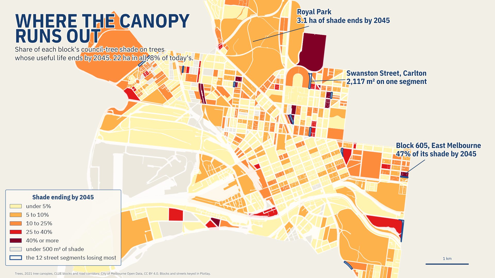
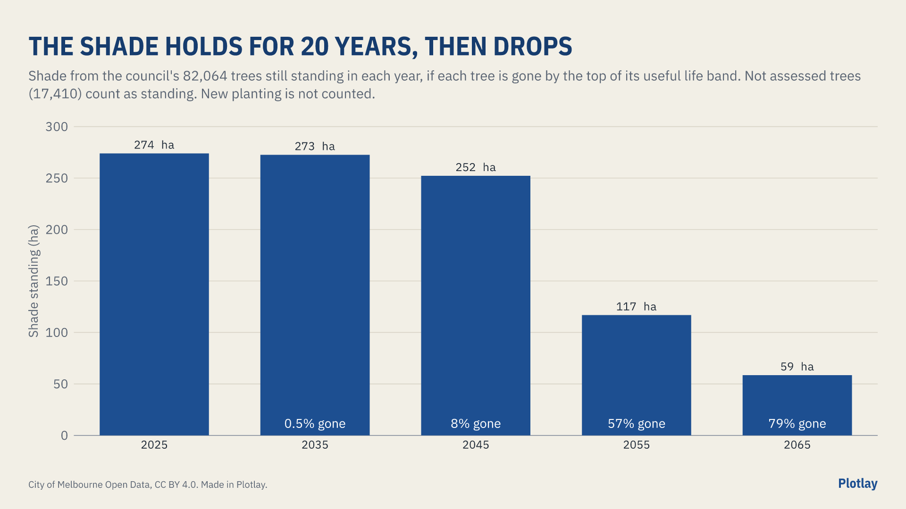

# Where the canopy runs out

Which City of Melbourne streets and blocks lose their council-tree shade over the next 20 years, from the council's own tree and canopy data. **Live version, with an interactive map:** [getplotlay.com/showcase/melbourne-canopy](https://www.getplotlay.com/showcase/melbourne-canopy/)



The City of Melbourne's 82,064 trees shade **274 hectares**. The council rates each tree's useful life left, in bands. On those ratings, **21.8 ha (8%) of the shade is on trees whose useful life ends by 2045**, and 57% by 2055. The biggest group going first is elms: 37% of that shade.

The council publishes each tree as a point with its band, and its canopy as outlines traced from 2021 aerial imagery. A point has no shade and an outline has no years left, and neither says which streets or blocks lose what. The shapes in this repository were made in [Plotlay](https://www.getplotlay.com) to join them.

[](https://app.plotlay.io/?example=melbourne-canopy&as=client)

## What the data says

| | |
|---|---|
| Council trees | 82,064, of which 59,440 have measured shade |
| Their shade (2021 canopy) | 274 ha of the municipality's 442 ha |
| Shade ending by 2035 | 1.4 ha (0.5%) on 663 trees |
| Shade ending by 2045 | 21.8 ha (8.0%) on 4,946 trees |
| Shade ending by 2055 | 157.2 ha (57.4%) |
| Elms' part of the 2045 loss | 8.0 ha (37%) |
| Block losing most by 2045 | Royal Park (block 931): 3.1 ha |
| Blocks losing a quarter or more by 2045 | 9 of the 262 with at least 2,000 m² of shade |
| Street losing most by 2045 | St Kilda Road: 5,259 m² (10%) |



### Read it carefully

- **The years are the council's bands.** A tree is taken as gone by the top of its band, counted from 2025 (the dataset's last update, 22 September 2025). The dataset does not say when each tree was rated, so these are the latest dates the bands allow. Useful life is a measure of healthy, safe years, not a removal date.
- **Not assessed trees count as standing.** 17,410 trees have no band; the portal's number column says 50 for them, which is a fill.
- **Shade is the 2021 outline, shared out.** A tree's share is the part of the outline its trunk stands in (or the nearest within 3 m) that is nearer to it than to any other council tree in that outline, within 15 m of the trunk. Only Mature and Semi-mature trees claim shade. A block or street total is steadier than any one tree's figure.
- **Council trees only.** Canopy in outlines holding no council tree (private gardens, trees the council does not manage) is left out.
- **No new planting.** This is the shade today's trees give, not a forecast of the city's canopy.

## How it was made with Plotlay

1. **Each tree's share of the 2021 canopy**, in Python (`data/trees/trees.csv`).
2. **A map project** on the Geoscience Australia base map, and a **Data layer** called Blocks ([Data layers](https://www.getplotlay.com/features)).
3. **Pick from a layer, Take all.** The council's CLUE blocks file, with its licence: all 603 blocks in one step, keyed by `block_id`.
4. **Place rows by their position.** `canopy_by_year.csv` (a row for every decade each tree still stands) drops into the blocks; the year is the time axis, 2025 to 2065. `trees.csv` shows every tree as a dot.
5. **Formula columns**: `canopy_2025` to `canopy_2065` (`coalesce(sum(canopy_m2, year = 2045), 0)`), `lost_by_2045`, `pct_lost_by_2045`, `trees` and `trees_ending_by_2045`.
6. **Streets**: the 1,809 road corridor segments holding a council tree, taken the same way and keyed by `seg_id`, with the same columns.
7. **Precincts**: the 13 CLUE small areas, with **roll-up columns** adding up the blocks inside each.
8. **Export** GeoJSON, TopoJSON, CSV with WKT, the linked tables and a Python starter. Plotlay's block totals match GeoPandas to within 153.3 m² per block. Nothing here comes from OpenStreetMap, and no imagery was traced.

## What's here

| Folder | What |
|---|---|
| [`data/geometry/`](data/geometry) | Blocks (key `block_id`), streets (key `seg_id`) and precincts from Plotlay: GeoJSON, TopoJSON, CSV with WKT, with the formula and roll-up columns |
| [`data/trees/`](data/trees) | `trees.csv` (every council tree, its band, `end_by` and `canopy_m2`) and `canopy_by_year.csv` (the slider's table) |
| [`python/`](python) | A narrated notebook that recomputes every number here: [`where_the_canopy_runs_out.ipynb`](python/where_the_canopy_runs_out.ipynb) |
| [`powerbi/`](powerbi) | A Power BI Project (`.pbip`). Start with [`powerbi/OPEN-ME.md`](powerbi/OPEN-ME.md) |
| [`visuals/`](visuals) | The maps, charts and animation; the charts made in Plotlay from the layers and tables here |

### Run the notebook

```
python3 -m venv .venv
.venv/bin/pip install -r python/requirements.txt
cd python && ../.venv/bin/jupyter lab where_the_canopy_runs_out.ipynb
```

### Open the Power BI report

Open `powerbi/MelbourneCanopy.pbip` in Power BI Desktop and select Refresh. [`powerbi/OPEN-ME.md`](powerbi/OPEN-ME.md) has the steps.

## Sources and licences

- **Code** (notebook, Power BI project): MIT, see [`LICENSE`](LICENSE).
- **Our data** (the shapes, the tables): CC BY 4.0, see [`LICENSE-DATA`](LICENSE-DATA). Credit "Plotlay (getplotlay.com)" and the sources below.
- Trees, with species and dimensions (Urban Forest), and Tree Canopies 2021 (Urban Forest): City of Melbourne Open Data, data.melbourne.vic.gov.au, CC BY 4.0.
- CLUE blocks, CLUE small areas and road corridors: City of Melbourne Open Data, CC BY 4.0.
- Base map in the app: © Commonwealth of Australia (Geoscience Australia), CC BY 4.0.

This is independent work using open data, not endorsed by the City of Melbourne. Full credits are in [`NOTICE`](NOTICE).
